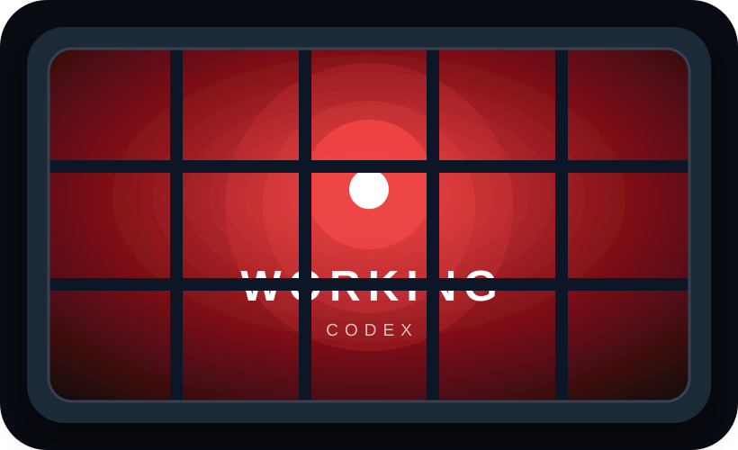

# Clawdeck

Clawdeck turns an Elgato Stream Deck into an ambient status display for Codex and Claude Code.

One local command installs the agent hooks and opens the bundled Stream Deck plugin. No API key, daemon, account, network server, or telemetry is involved.



- red: an agent is working
- green: the agent finished and is waiting for you
- amber: permission or input is required
- dark red: the turn failed
- gray: no session is active

## Highlights

- A true whole-deck mosaic: every key renders the correct slice of one continuous scene.
- Signal, Orbit, and Minimal scenes with subtle working/input animation.
- Per-action filtering for Codex, Claude Code, or the most important active session.
- Multiple concurrent terminals and agents, aggregated by urgency.
- Native Stream Deck Property Inspector configuration.
- Safe, idempotent hook installation with backups and selective uninstall.
- WSL-to-Windows state sharing without opening a local port.
- Stale-session recovery when a terminal exits uncleanly.

## Install

Requires Stream Deck 7.1 or newer on Windows 10+ or macOS 13+, plus Node.js 20.5.1 or newer for the installer CLI.

The intended release flow is one command:

```bash
npx @volkm/clawdeck install
```

The CLI merges lifecycle handlers into `~/.codex/hooks.json` and `~/.claude/settings.json`, preserving existing settings and writing `.clawdeck-backup` files before changes. It then opens the bundled `Clawdeck.streamDeckPlugin` installer. Codex requires one explicit trust review for newly installed user hooks; run `/hooks` in Codex after installation.

After installing the Stream Deck plugin, drag **Agent Status Tile** onto every key that should participate. In the action settings choose:

- **Whole-deck mosaic** for a continuous image across the physical grid.
- **Individual tile** for a compact standalone indicator.
- An agent filter and visual scene for each action.

The default is the Signal mosaic showing the most urgent state across all agents.

Useful commands:

```bash
clawdeck doctor
clawdeck doctor --json
clawdeck status
clawdeck event working --agent manual
clawdeck reset
clawdeck install-plugin
clawdeck uninstall
```

Install only one agent integration when desired:

```bash
npx @volkm/clawdeck install --no-claude
npx @volkm/clawdeck install --no-codex
```

`uninstall` removes only Clawdeck hook handlers and leaves unrelated hooks, the Stream Deck plugin, backups, and state history untouched.

## WSL and Windows

When installed inside WSL, the CLI resolves Windows `%LOCALAPPDATA%` and writes the shared state to `Clawdeck/state.json` there. The Windows Stream Deck plugin reads the same file. Override discovery with `CLAWDECK_STATE_DIR` or `CLAWDECK_STATE_FILE`.

Sessions older than 24 hours are treated as offline. For development this can be changed with `CLAWDECK_STALE_AFTER_MS`.

## Privacy and security

Clawdeck stores only agent name, lifecycle state, an opaque session ID, and timestamps in a local JSON snapshot. It does not store prompts, responses, working directories, notifications, or error text and sends nothing over the network. See [Security policy](SECURITY.md) and [Architecture](docs/architecture.md).

## Development

Requirements: Node.js 20.9 or newer for repository development. The installed CLI supports Node.js 20.5.1 or newer. Elgato currently recommends Node.js 24 and Stream Deck 7.1 for plugin development.

```bash
npm install
npm run assets
npm run release:check
npm run build
npm run check
npm run lint
npm test
npm run pack:plugin
```

Launch the interactive hardware-free simulator, then open the printed local URL:

```bash
npm run simulator
```

It uses the production SVG renderer and supports every state, scene, agent, and common Stream Deck grid size.

To link the development plugin into Stream Deck:

```bash
npm run link -w @clawdeck/streamdeck-plugin
```

To test hook installation without opening the Stream Deck installer:

```bash
node packages/cli/dist/cli.js install --no-streamdeck
```

## Release artifacts

`npm pack -w @volkm/clawdeck` runs the plugin validator/packer, vendors the resulting `.streamDeckPlugin`, builds the standalone CLI, and creates an npm tarball containing both pieces. The CLI is bundled, so users do not need the private workspace packages.

Publish the scoped public package after authenticating with npm:

```bash
npm publish -w @volkm/clawdeck
```

## Architecture

The installed hook runner has no dependencies and receives lifecycle JSON on stdin. It atomically updates a versioned snapshot, keyed by agent and session. The Stream Deck plugin polls that snapshot locally and renders SVG images through the official Stream Deck SDK. No API key, server, or cloud service is involved.

See [docs/architecture.md](docs/architecture.md) for lifecycle mapping, state priority, concurrency behavior, rendering, and trust boundaries. Contributions are welcome; start with [CONTRIBUTING.md](CONTRIBUTING.md).

Supported and runtime-verified versions are tracked in [docs/compatibility.md](docs/compatibility.md).
